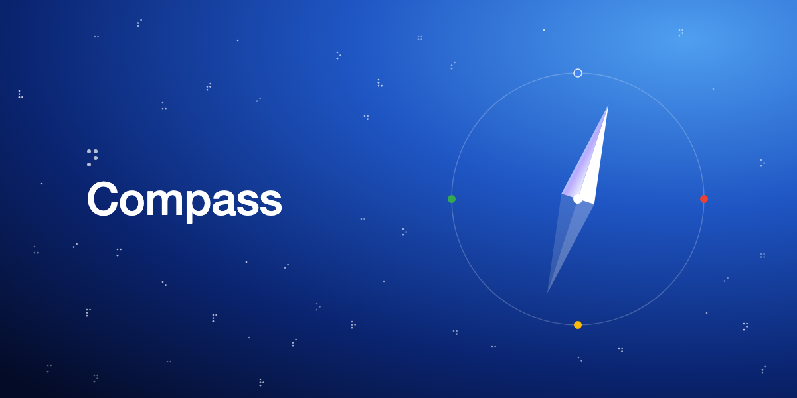

# Compass

**Demo video (1:51):** [docs/video/compass-demo.mp4](docs/video/compass-demo.mp4)

**Paper (PDF):** [docs/paper/compass-paper.pdf](docs/paper/compass-paper.pdf) · [Markdown](docs/paper.md) · [LaTeX source](docs/paper/main.tex)

Live: https://copilot-embrfilgsa-uc.a.run.app (pick "copilot")

A voice browser agent for blind and low-vision users. You say what you want done ("pay my rent to jane@rent.example, at most 1200 dollars, on QuickPay"); the agent reads the page from Chrome's accessibility tree, fills the form and clicks. A Guardian checks every action against what you said, so a hidden instruction on the page cannot redirect the money.

Built on Google ADK, Gemini on Vertex AI, Model Armor, Web Risk, Firestore and Cloud Run ([STACK.md](STACK.md)).

## How it works

```
voice / text ──> orchestrator (Gemini)
                   ├─ set_mandate: your sentence -> recipient, amount, site, expiry
                   ├─ reader:    page snapshot -> spoken summary
                   └─ navigator: click / fill / navigate via chrome-devtools-mcp
                                    │
                         Guardian plugin (before every tool call)
                           ├─ blocks actions outside the mandate
                           ├─ asks for a spoken yes before money moves
                           ├─ Model Armor flags page text aimed at AI agents
                           ├─ Web Risk blocks known phishing and malware
                           └─ Firestore receipt with the user's own words
```

Code: `agent/copilot/` (agents, Guardian, policy), `extension/` (Chrome extension), `agent/demo/` (demo bank and shop pages).

## Run it

```bash
cd agent && uv run adk web                                # http://localhost:8000, pick "copilot"
python3 -m http.server 8765 --directory agent/demo        # demo pages
cd agent && uv run pytest && cd .. && npm install && npm test
```

Needs Chrome 144+ with remote debugging on (`chrome://inspect/#remote-debugging`), uv, Node 20+ and a Google Cloud project. Setup, deploy and repo rules: [AGENTS.md](AGENTS.md).

## License

MIT
